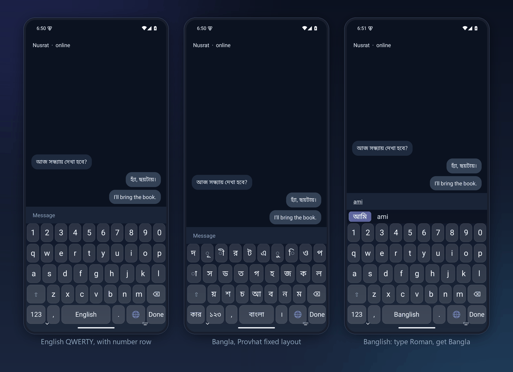
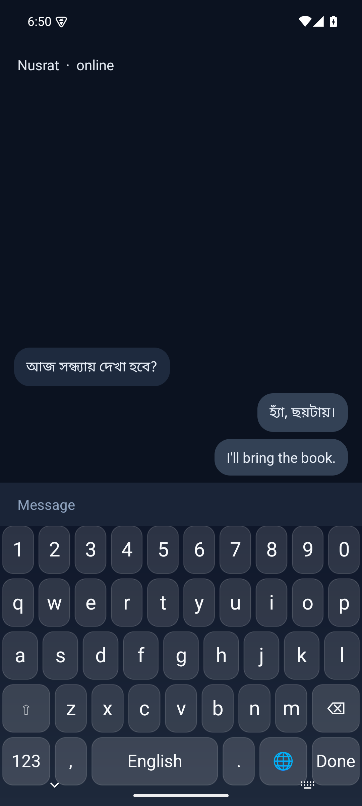
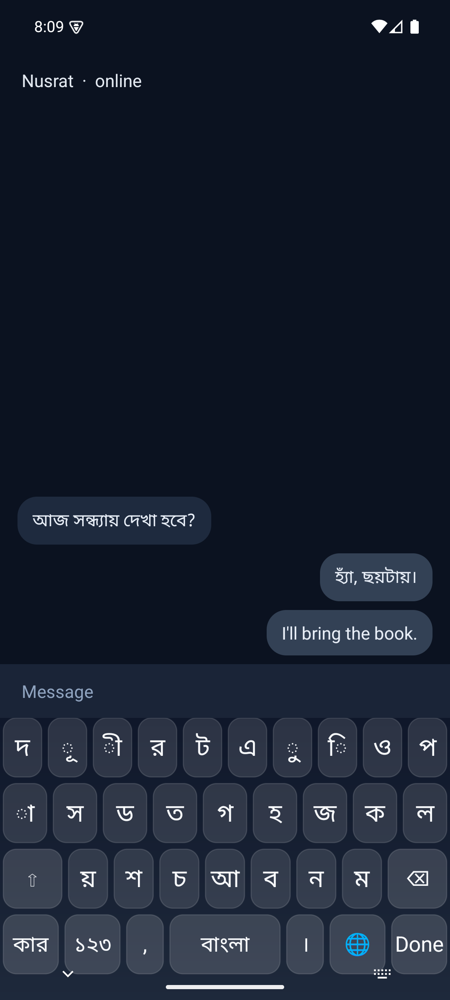
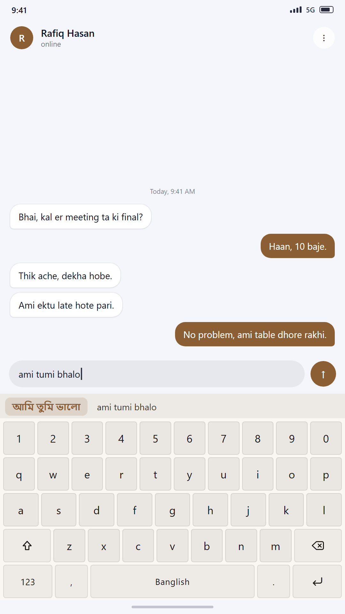
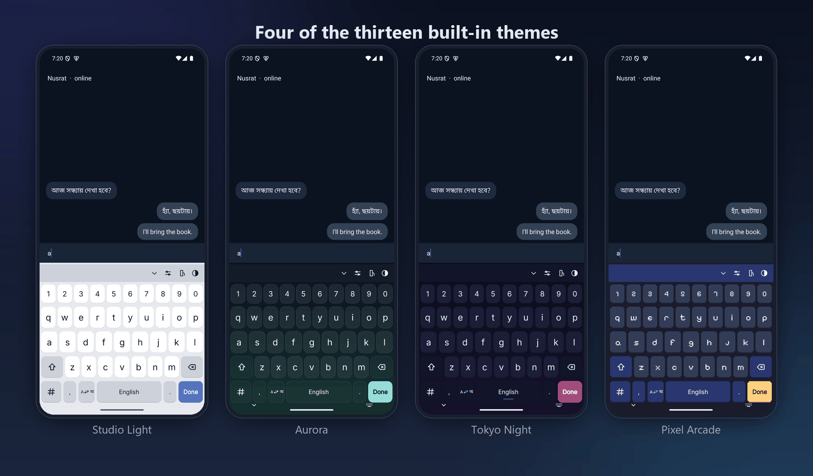
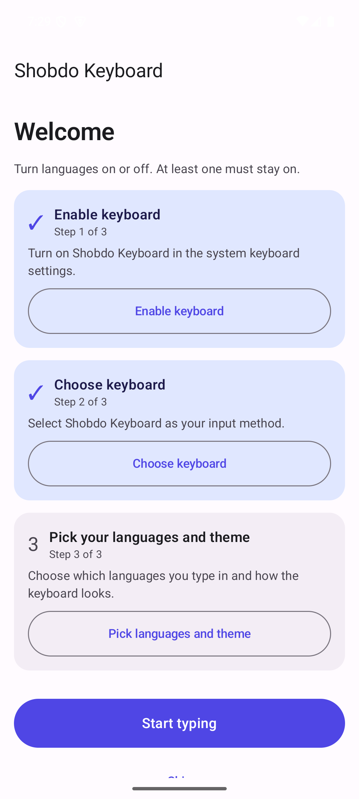
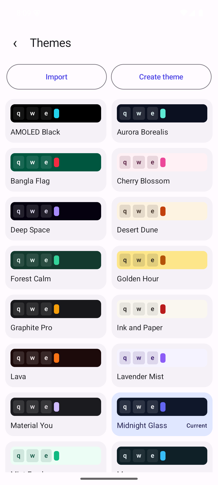
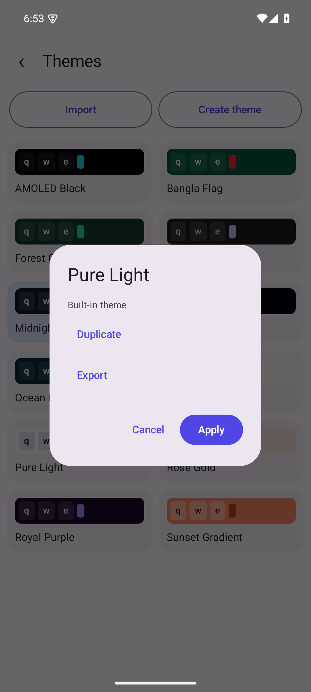

<div align="center">


# Shobdo Keyboard

**Type Bangla, Banglish and English on Android — offline, private and beautiful.**

[](https://github.com/34rns/shobdo-keyboard/releases)
[](LICENSE)
[](#install)
[](CONTRIBUTING.md)

</div>

## Why Shobdo Keyboard

**Bangla, Banglish and English in one keyboard.** A fixed Probhat-style Bangla layout for
people who know the letters, and a phonetic Banglish mode for people who think in Roman
letters — `ami` becomes আমি. English is one tap away, and every language can be switched
off individually.

**Themes that look designed, not defaulted.** Twenty-four built-in themes, from AMOLED Black to
Rose Gold, each checked against a 4.5:1 contrast floor on the actual composited key colour.
Themes are plain JSON, so you can write your own and share it.

**Private by design.** The app has no `INTERNET` permission, no analytics, no ads and no
tracking libraries. Not "we promise not to look" — the operating system prevents the app
from making a connection at all. See [PRIVACY.md](PRIVACY.md).

## Screenshots



| English | Bangla | Banglish |
|:---:|:---:|:---:|
|  |  |  |
| Number row, glass keys | Probhat fixed layout | Type Roman, get Bangla |



| Settings | Theme picker | Theme actions |
|:---:|:---:|:---:|
|  |  |  |
| Languages, theme, typing | Twenty-four themes, live preview | Duplicate, export or apply |

Every image above is a real capture: the debug build running on Android 15, photographed with
`adb exec-out screencap` while the keyboard was the active input method, in a debug-only demo
chat screen that never ships in a release APK. `scripts/screenshots.ps1` replays the sequence
and `scripts/compose_screenshots.py` builds the composites.

## Features

- **Three languages, remembered.** English (QWERTY), Bangla (Probhat fixed layout) and
  Banglish (phonetic Roman input). The globe key cycles only the languages you enabled, and
  at least one always stays on.
- **Shift that behaves.** One tap for a single capital, double tap for caps lock, with the
  state visible on the key.
- **Repeat delete.** Hold backspace to delete continuously, after a short delay.
- **Two symbol pages** plus a Bangla digits page with ৳ and Bengali punctuation.
- **Long-press accents.** Hold a vowel for é è ê ë, and digits for `!@#$%` and friends.
- **Bangla composing.** Kar signs, hasanta joining and one-unit backspace that removes a
  base letter together with its kar.
- **Suggestion bar** with the Bangla candidate first, the Roman text second, and a tap to
  commit either.
- **Twenty-four themes** with live preview, plus duplicate, create, export and import.
- **Adjustable everything:** key height, spacing, corner radius, font size, bold, borders,
  number row, haptic strength and one-handed mode.
- **Dark and light,** following the system, with Material You colours on Android 12+.
- **Accessible:** every control has a content description and at least a 48dp touch target;
  the settings app is translated into Bangla.

## Install

1. Download the latest `Shobdo-Keyboard-v*.apk` from
   [Releases](https://github.com/34rns/shobdo-keyboard/releases).
2. Open the file on your phone and allow installing from this source when asked.
3. Open **Shobdo Keyboard** and follow the three setup steps: enable the keyboard, choose
   it, then pick your languages and theme.
4. In any text field, tap the globe key to switch languages.

Requires Android 8.0 (API 26) or newer.

## Build from source

You need JDK 17 or newer and Android SDK Platform 35.

```bash
git clone https://github.com/34rns/shobdo-keyboard.git
cd shobdo-keyboard

# Point Gradle at your SDK (create this file once per machine; it is gitignored)
echo "sdk.dir=$ANDROID_HOME" > local.properties

./gradlew :app:assembleDebug        # APK: app/build/outputs/apk/debug/
./gradlew :app:testDebugUnitTest    # unit tests
./gradlew :app:lintDebug            # lint report: app/build/reports/
```

To check the bundled layout, theme and translation data without a full build:

```bash
python scripts/validate-layouts.py
python scripts/validate-themes.py
python scripts/validate-strings.py
python scripts/banglish_check.py
```

## Banglish typing guide

Type Roman letters; the suggestion bar shows the Bangla word. Press space to accept it, or
tap the Roman chip to keep the English.

| You type | You get | Meaning |
|---|---|---|
| `ami` | আমি | I |
| `tumi` | তুমি | you |
| `bhalo` | ভালো | good |
| `bangla` | বাংলা | Bangla |
| `kotha` | কথা | word, talk |
| `desh` | দেশ | country |
| `amar` | আমার | my |
| `pr` | প্র | conjunct (p + r) |
| `kya` | ক্যা | k + ya-phala |
| `123` | ১২৩ | Bangla digits |

The scheme follows the widely used Avro Phonetic conventions: `kh` is খ, `sh` is শ, `Sh` is
ষ, `Ng` is ঙ, `T`/`Th` are ট/ঠ, and `,` alone stays a comma while `,,` inserts a hasanta.
A few dictionary-dependent edge cases differ from Avro and are listed in
[docs/BANGLISH.md](docs/BANGLISH.md).

## Custom themes

Themes are JSON with colours, a background (solid, gradient or your own image), key styling
and fonts. The full schema, the contrast rule and how customisation differs from app
settings are in **[docs/THEME_FORMAT.md](docs/THEME_FORMAT.md)**.

## Roadmap

- [x] Layout data for English, Bangla (Probhat) and Bangla digits
- [x] Phonetic Banglish rules with a verified test fixture
- [x] Canvas keyboard core: drawing, touch handling, input connection
- [x] Language switching and Bangla composing
- [x] Settings app with onboarding and live theme preview
- [x] Twenty-four themes, contrast-checked
- [x] Signed APK, screenshots and the v0.1.0 release
- [ ] Small handwritten word list to improve Banglish suggestions
- [ ] Automatic reph (র্) in Banglish words like `kormo` → কর্ম
- [ ] More layouts (Jatiya, phonetic Bangla)

## Contributing

Bug reports, translations and themes are all welcome. Please read
[CONTRIBUTING.md](CONTRIBUTING.md) and the [Code of Conduct](CODE_OF_CONDUCT.md) first.
Security issues go through [SECURITY.md](SECURITY.md), not the public tracker.

## License

[MIT](LICENSE) © 34rns
